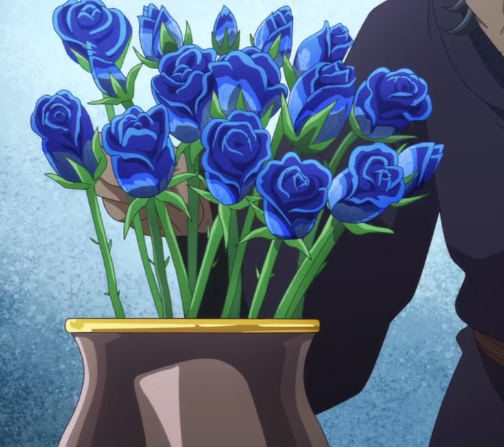

# Blue-Roses
<html lang="en">
<head>
  <meta charset="UTF-8">
  <meta name="viewport" content="width=device-width, initial-scale=1.0">
  <title>My Webpage</title>
  
    <body>

    

   
 
   
aaaaadkdfjoifjiushffff 

   

   <footer>
        <a href="https://ayana-sarkar.github.io/1st_rough_jjk/" class="btn" > ingredients </a>
    </footer>
</body>
</html>
